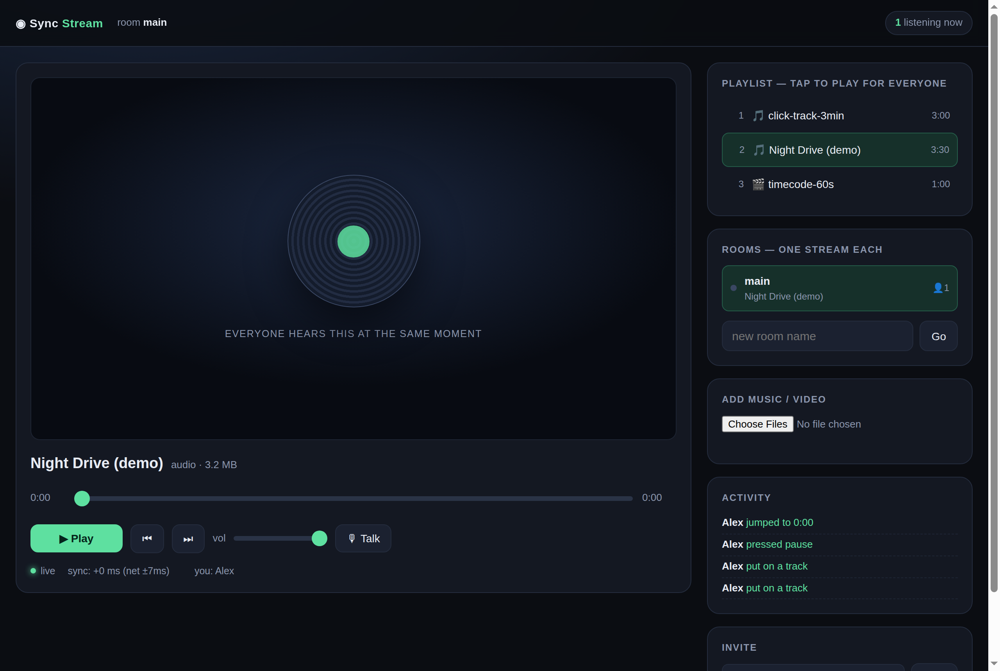
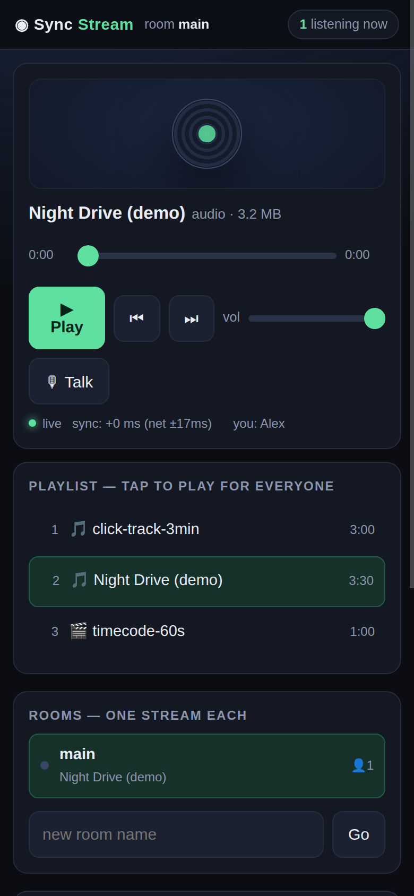
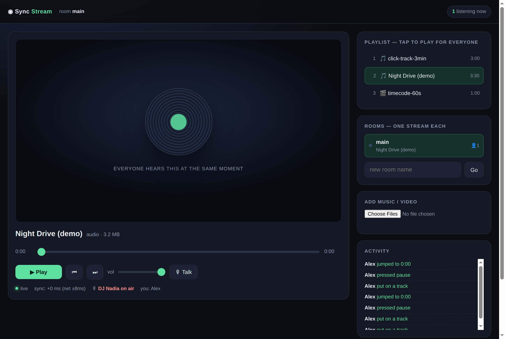

# Sync Stream

**Everyone hears the same second.** A tiny self-hosted listening room: one shared playhead, any
number of devices, no app to install. Anyone can play, pause, seek or change the track and every
other listener follows within a fraction of a second. A room also keeps playing when nobody is
listening — close your phone and the station rolls on.

One Node file, **zero npm dependencies**, no build step.

```
docker compose up -d      # then open http://localhost:8080
```



*Desktop: one shared playhead, a playlist anyone can drive, rooms with what each is playing, and the
DJ talk button. The status row shows the live link and the current sync error — here `sync: +0 ms
(net ±8ms)`.*

### On a phone



*The player collapses to a compact card (audio does not need a cinema above the fold) so the playlist
and rooms are reachable without scrolling.*

### DJ push-to-talk



*While someone is talking, the room reports it and every device ducks the music to 18 % — quieter,
not muted — then fades it back.*

## What it does

- **Tight sync, server-authoritative.** The server publishes `{posMs, anchor}` (the server clock at
  which the position was true); clients learn the server clock from four quick round trips and
  derive the same target position regardless of their own clock or network latency. Measured
  between two browsers: **10–150 ms**.
- **Anyone can drive.** Play, pause, seek, next/previous, change track. The change is pushed to
  every listener immediately (SSE), so there is no "host" device to keep open.
- **Rooms.** Each room is its own stream with its own playlist position, volume and listeners.
  Create one from the UI, share `/r/<name>`. Rooms and what they were playing survive a restart.
- **A station, not a record player.** The server advances the playlist on its own, so a track that
  ends while everyone's browser is closed does not freeze the stream. With listeners present the
  client's own `ended` event wins (exact track endings); the server only steps in as a rescue.
- **DJ push-to-talk.** Tap 🎙 Talk and your microphone is relayed to everyone in the room while the
  music automatically ducks to ~18 % on every device — quieter, not muted — then comes back.
- **Shared volume.** The volume slider is a room setting: turn it down once and it goes down
  everywhere, like one speaker.
- **Optional password.** A shared word (or several) gates the page and the API. Media files stay
  open on purpose, so the edge cache keeps serving audio cheaply.
- **Background friendly.** Audio plays through a real `<audio>` element with Media Session metadata,
  so Android/iOS keep it alive when the tab is backgrounded and the lock-screen controls drive the
  room.

## Configuration

| Variable | Default | Meaning |
|---|---|---|
| `PORT` | `8080` | listen port |
| `MEDIA_DIR` | `/media` | where the music and video live |
| `DATA_DIR` | `/data` | room registry (`rooms.json`) |
| `SYNC_PASSWORDS` | — | comma/newline separated shared words; any one opens the site |
| `SYNC_PASSWORDS_FILE` | — | same, read from a mounted file (use this in containers) |
| `MAX_UPLOAD_BYTES` | 4 GiB | upload cap |

Set **neither** password variable and the site is open. If `SYNC_PASSWORDS_FILE` is set but
unreadable the server fails *closed* (locked, loudly logged) rather than quietly opening up.

Music and video are added either from the page (**Add music / video**) or by dropping files into
`MEDIA_DIR`. Accepted: `mp3 m4a aac ogg opus wav flac` and `mp4 m4v mov mkv ogv webm`. Files are
served with HTTP range requests, so seeking works without downloading the whole thing.

## How the sync works

The server is the only source of truth. Every state change publishes an anchor:

```json
{ "mediaId": "song.mp3", "playing": true, "posMs": 0, "anchor": 1792125755489 }
```

`anchor` is the *server* clock (epoch ms) at which `posMs` was true, so a client's target position is
`posMs + (server_now − anchor)` while playing. Each client estimates `server_now` from four
`/api/time` round trips and keeps the sample with the lowest RTT, which cancels its own clock offset
*and* the network delay. Every 200 ms a client:

- **snaps** (`currentTime = target`) when anyone changes something, when a new file loads, when the
  error passes 600 ms, or when it passes 200 ms and 2.5 s have gone by since the last snap;
- otherwise closes the remaining gap with a ±5 % `playbackRate` nudge, which is inaudible.

The snap is the guarantee, the nudge is the polish: a browser that ignores small playback-rate
changes still lands in sync, because the snap path alone can always fix the error.

## DJ push-to-talk

The browser captures the microphone, decimates it to 12 kHz mono PCM, and posts ~340 ms batches.
The server relays each batch to every listener as an SSE `talk` event and marks the room as talking,
which is what makes every device duck. Raw PCM (no codec) is deliberate: it is the one audio format
every browser can decode, so playback goes through Web Audio and works the same on Android, iOS and
desktop — no container/codec support matrix. The cost is bandwidth: roughly 32 KB/s per listener
while someone is talking (music playback itself is a normal file, so it stays cheap).

Details that matter:

- the talker's own batch is **never relayed back to the device that sent it** (`x-cid`), so you do
  not hear yourself a second later; the local mic is also routed to a muted gain node;
- the room reports who is talking, and every listener fades the music down rather than cutting it;
- a talk session expires on its own after 3.5 s of silence, so a phone that drops off does not leave
  everyone ducked forever.

## Notes and limits

- **Rooms live in memory and are checkpointed to `DATA_DIR/rooms.json`** — a few hundred bytes, not a
  database. A redeploy restores the stations and fast-forwards their playhead by the downtime.
- **A full browser restart still needs one tap** before audio can start: that is the browser autoplay
  policy, not something a page can bypass. An ordinary backgrounded tab keeps playing.
- **iOS ignores `element.volume`**, so the shared volume cannot be applied on iOS by the browser
  (the on-device volume buttons still work). Talk playback itself works, since it goes through
  Web Audio.
- **Media files are not behind the password.** The page and the API are; a copied media URL is
  harmless, and leaving media open lets a CDN cache it.
- Durations come from two sources: any client measures the length of files it does not know yet, and
  `python3 scripts/scan-media.py` fills in a whole library with ffprobe after a bulk copy.

## Testing

```bash
node server.js &                                  # or: docker compose up -d
python3 test/test_protocol.py http://127.0.0.1:8080
python3 test/test_talk.py     http://127.0.0.1:8080 <password>   # omit the password if unset
```

`test_protocol.py` covers the transport: SSE, the playhead advancing 1:1 with real time, seeking,
pausing, roll-on when a track ends, upload, rejection of non-media, path traversal. `test_talk.py`
covers the gate and the talk relay: login, page/API locking, room volume, PCM relayed intact, the
talker not receiving their own audio, and the session expiring after silence.

## Deployment notes

Behind a reverse proxy, give the app plain HTTP and let the proxy do TLS. Two things are worth
knowing:

- **`/api/events` is an SSE stream** — make sure response buffering is off on the proxy, or state
  changes arrive late. `x-accel-buffering: no` is already sent.
- **If your CDN caches media**, keep media on a path it caches and the page/API on a path it does
  not; that is how the password gate stays effective while audio stays cheap.

## License

MIT — see [LICENSE](LICENSE).
